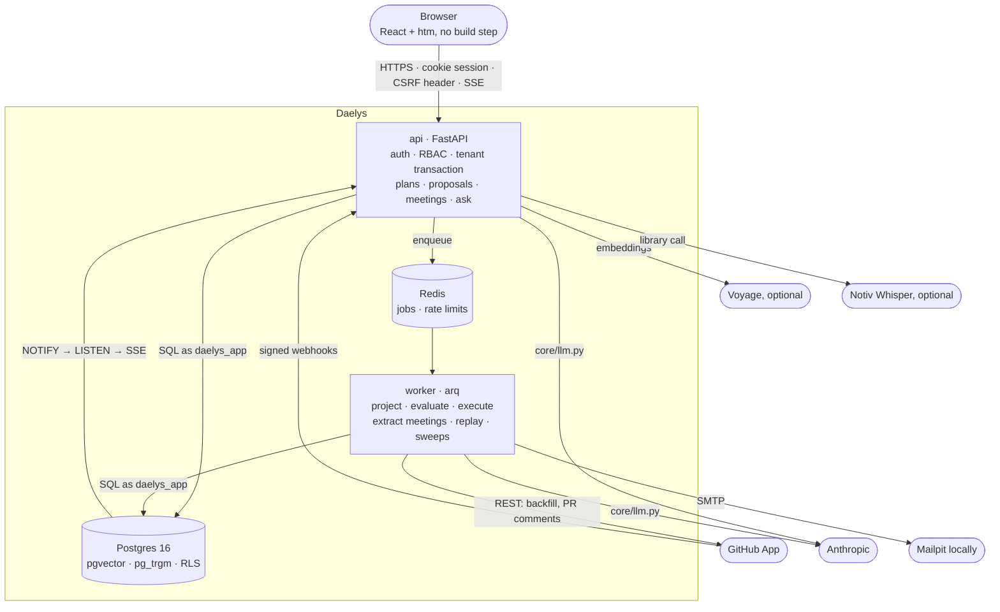
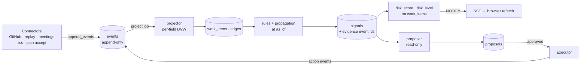
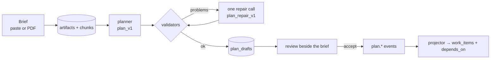
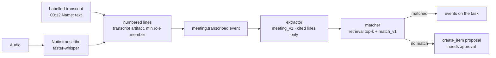
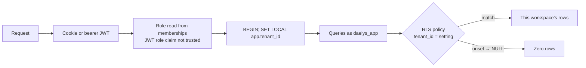
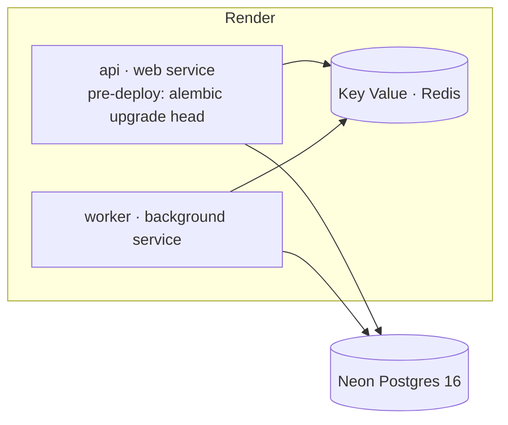

# Architecture

Every decision mentioned here has its reason in [Technical decisions](TECHNICAL_DECISIONS.md) (IDs such as S3-02).

## 1. System context

Two processes share one database and one Redis. The API answers requests and enqueues work; the worker projects
events, scores risk, executes approved proposals and extracts meetings. Both connect as `daelys_app`, a role that
can't bypass row-level security.

## 2. Code layout

| Path | Role |
| --- | --- |
| `api/` | FastAPI app. `deps.py`: authentication and the per-request tenant transaction. `bodies.py`: size-capped request bodies. `routes/`: auth, events, work items, webhooks, connectors, projects (briefs, plans), risk, proposals, collaboration |
| `core/` | config, DB and RLS helpers, `append_events`, security (JWT, bcrypt, roles), LLM gateway, briefs, plans, actions, proposals, meetings, retrieval, insights, realtime, sandbox, mailer, rate limiting, seed |
| `connectors/` | GitHub (webhook verification, normalisation, REST backfill), scenario replay, Notiv (meetings), `.ics` |
| `workers/` | `projector.py` (events → work items), `execute.py` (the only writer of actions), `main.py` (arq jobs and cron) |
| `rules/` | `checks.py` (five rules), `propagation.sql` (slip CTE), `scoring.py` (formula), `engine.py` (evaluate, persist, health, time machine) |
| `agents/` | planner and validators, explainer, LangGraph proposer and its read-only tools, meeting extractor, matcher, writers, citation checker, prompt store |
| `agents/prompts/` | nine versioned prompts (`plan_v1.md`, `explain_v1.md`, `propose_v1.md` …) |
| `evaluation/` | DaelysBench suites, datasets, generated results |
| `migrations/` | Alembic 0001–0006: schema, RLS policies, app role, grants, indexes, demo reset function |
| `web/` | the single-page app served at `/` |

## 3. The spine: events → projection → risk → proposals → actions

### 3.1 Events are the source of truth

- Every fact enters as a row in `events`. The app role has no `UPDATE` or `DELETE` grant on `events` or
  `audit_log`.
- `append_events` (`core/events.py`) is idempotent on `(tenant_id, idempotency_key)`, so a webhook delivered twice
  is stored once.
- A per-tenant advisory lock makes event IDs commit in order, which keeps the projector's cursor safe (S1-02).
- The only deletion of events is demo reset, and the database function behind it refuses non-demo tenants (S5-07).

### 3.2 Projection that doesn't depend on arrival order

GitHub webhooks arrive late, out of order and twice.
- `workers/projector.py` folds events past its cursor into `work_items` and `edges`.
- It stores a version per field, `(occurred_at, idempotency_key)`, and applies last-writer-wins per field. A late
  "closed" can't be overwritten by an earlier "edited" (S1-01).
- An event that fails to apply is skipped and logged; it never blocks the projector (S1-03).
- Tests throw the projection away, replay the log and get the same rows back.

### 3.3 Risk is computed

The five rules in `rules/checks.py` are SQL over the projection at an explicit `as_of` time (S3-01). Each returns
signals with the event IDs that justify them.

| Rule | Fires when | Severity |
| --- | --- | --- |
| `stale_pr` | A PR has had no activity for `stale_pr_days` (3) and its task is due within `due_window_days` (5) | medium; high if due within 2 days |
| `ci_failing_near_due` | The PR that closes the task has CI status `failure` and the task is due within the window. Cites the last three failed runs | high; critical within 1 day or overdue |
| `overdue_upstream` | A task this one depends on is overdue or blocked | high if overdue; medium if blocked |
| `explicit_blocker` | Someone reported a blocker on the task in the last `blocker_window_days` (7) | high |
| `owner_overloaded` | The owner has more than `overload_limit` (3) open tasks due in the next 7 days | low; medium above the limit + 2 |

`rules/propagation.sql` is a recursive CTE that pushes projected slip down `depends_on` edges, so a late checkout
makes the pricing page late too (S3-03).

**Scoring** (`rules/scoring.py`, S3-02):
- Severity points: low 15, medium 35, high 60, critical 85.
- Slip points: 0 when on time, else `min(85, 35 + 10 × ceil(slip days))`.
- Score = `100 × (1 − Π(1 − pᵢ/100))` over a task's points. This noisy-OR lets two medium reasons outrank one, and
  a single reason scores itself.
- Levels: *at risk* ≥ 60, *watch* ≥ 30, else *on track*. Project and workspace health is the worst level among
  active tasks.

There is no model call anywhere in `rules/`. Risk depends on time as well as events (a PR goes stale with no new
event), so the worker re-evaluates every 10 minutes.

### 3.4 Explanations carry their evidence

- Untrusted text (briefs, PR bodies, comments, transcripts, titles) is escaped into numbered `<evidence>` blocks in
  the **user** turn, never the system prompt (`agents/prompt_store.py`).
- `agents/citations.py` keeps a sentence only if every `[evt:ID]` / `[doc:ID]` it cites was in the evidence the
  model was given (S2-04). Sentences without a valid citation are dropped.
- Explanations are optional; the signals and their evidence are always shown (S3-06).

### 3.5 Proposals: read-only by construction

`agents/proposer.py` is a LangGraph graph: **gather → propose → validate** (S4-01).
- Its tools run inside `READ ONLY` Postgres transactions, so it physically can't write.
- The model can only return one of the five typed actions (`core/actions.py`). Off-list actions, unknown targets
  and @mentions are rejected and recorded in the audit log.
- Valid drafts are stored as pending `proposals` with an exact preview of what will change.

### 3.6 Execution: exactly once, by one writer

`workers/execute.py` is the only code that writes actions (S4-04).
- It acts only on an approved, unexpired proposal, and re-checks the task's state at execution time.
- Permission is `min(agent role, approver role)`, read at execution time. A lead demoted after approving can't push
  the action through.
- Row locks and idempotency keys mean four concurrent executions of one proposal produce one effect (tested).
- **Tier 2 (workspace):** writes action events that can be undone with inverse events, so the log stays
  append-only (S4-06).
- **Tier 3 (external):** a PR comment carries a hidden marker. If the worker crashes between sending and
  recording, the sweep finds the marker and records it instead of posting twice.
- Every step writes `audit_log`, with the agent as a principal.

## 4. Planning

Validators (`agents/plan_validators.py`, no model) drop any task whose quote isn't found in the brief, duplicate or
empty tasks, estimates outside 1–365 days, self-dependencies and cycles. Problems go back to the model once (S2-05). Contradictions in the brief become open questions. Accepting a plan writes
events only; it never edits work items directly (S2-06).

## 5. Meetings

- Speakers map to members through an explicit mapping, else a unique first-name match. Unmapped speakers are listed
  for a lead to map once.
- Audio has no speaker labels (no diarization), so labelled transcripts are preferred when owners matter.
- Notiv is used as a library from `NOTIV_PATH`. Without it, audio upload answers `503 not_configured` (S5-03).

## 6. Retrieval, summaries and Ask

- `core/retrieval.py` uses pgvector when an embedding provider is configured. Otherwise it uses Postgres full-text
  search over `chunks` and `events` and trigram similarity over task titles. Every result says which mode was
  used (S5-05).
- Documents carry `min_role`. Retrieval filters on the caller's role **in SQL, before ranking**.
- Weekly summaries are per lane, Monday to Monday UTC. Ask answers pass the citation checker; if nothing cited
  survives, the answer is "Not enough evidence".
- Duplicate detection: trigram similarity ≥ 0.45 finds candidates, a model confirms, and a lead decides.

## 7. LLM gateway

`core/llm.py` is the only way to call a model.
- It walks an ordered `provider:model` chain (`LLM_ROUTES`) and falls back on timeout, 429, 5xx or refusal.
- It asks for structured output validated by Pydantic.
- It writes one `agent_runs` row per attempt: model, provider, prompt version, tokens, latency, cost and whether it
  fell back.
- With no key, model endpoints answer `503 not_configured`, and the bench stops before any call.

## 8. Jobs and live updates

| Job | Trigger | Does |
| --- | --- | --- |
| `project` | after any append; `sweep` every 30 s | Folds new events into work items, then evaluates risk and suggests duplicates (when a model is configured) |
| `evaluate` | after projection; `risk_sweep` every 10 min | Runs the rules and propagation, writes signals and risk columns |
| `execute_proposal` | on approval | Runs one approved proposal |
| `proposals_sweep` | every minute | Expires stale proposals and settles tier-3 actions interrupted mid-flight, never re-sending them |
| `extract_meeting` | after a transcript is stored | Extraction and matching, then projection and risk |
| `github_backfill` | `POST /connectors/github/backfill` | Pulls issues and PRs from a resumable cursor |
| `replay_scenario` | time machine replay | Replays a scenario into a copy of the workspace |

**Live updates.** Risk changes `NOTIFY` a channel. The API holds one `LISTEN` connection and fans changes out to
server-sent event streams; the browser keeps one shared `EventSource` per tab and refetches (S3-07). If the
`LISTEN` connection is lost, every stream ends after one refetch, the browser reconnects, and listening resumes.

## 9. Data model

| Table | Holds |
| --- | --- |
| `tenants`, `users`, `memberships` | Workspaces, people and their role per workspace (`owner`, `lead`, `member`, `viewer`, `agent`) |
| `projects`, `project_members` | Projects and project leads |
| `events` | The append-only log: source, type, actor, payload, `occurred_at`, idempotency key |
| `work_items`, `edges` | The projection: tasks with lane, owner, due date, source span, risk columns; `depends_on` and `closes` edges |
| `artifacts`, `chunks` | Briefs and transcripts with `min_role`, split for search (optional 1024-dim embeddings) |
| `plan_drafts` | Proposed plans awaiting review |
| `signals`, `policies` | Rule output with evidence IDs; per-workspace thresholds and auto-approval tier |
| `proposals`, `audit_log` | Proposal lifecycle; every decision and action |
| `agent_runs` | One row per model attempt |
| `meetings`, `speaker_mappings`, `summaries`, `duplicate_suggestions`, `comments` | Collaboration features |
| `integrations`, `connector_cursors` | GitHub installations; resumable cursors for the projector and connectors |

SQL goes through SQLAlchemy Core `text()` with bound parameters; there are no ORM models (S1-06).

## 10. Security model

- **Isolation that fails closed.** Every table has `tenant_id` and a policy
  `tenant_id = NULLIF(current_setting('app.tenant_id', true), '')::uuid`. If code forgets to set the tenant, the
  comparison is `NULL` and the query returns zero rows (S1-04).
- **Least privilege.** `daelys_app` is not a superuser, has no `BYPASSRLS` and owns no tables (S1-05). Migrations
  run as the owner; the running app never needs the owner's credentials.
- **Pre-tenant lookups** (workspace by slug, workspace by GitHub installation, list of workspace IDs) are three
  `SECURITY DEFINER` functions that return IDs only.
- **Web.** httpOnly `SameSite=Strict` session cookie; writes with a cookie need the `X-Daelys-CSRF: 1` header; strict
  CSP (`script-src 'self'`); same origin only, no CORS; `Referrer-Policy` everywhere and HSTS when
  `COOKIE_SECURE`.
- **Limits.** Login: 10 per minute per client IP and per account. Each model endpoint: 20 per minute per
  workspace. Request bodies are capped while streaming, so a chunked upload can't exhaust memory.
- **Webhooks.** GitHub signatures are verified; with no secret configured, webhooks are refused with 503.
- **Prompt injection.** Untrusted text is evidence, never instructions (section 3.4). The safety suite gates CI.

## 11. Observability

- JSON logs with no tokens, passwords or transcripts; an `x-request-id` on every response.
- `agent_runs` for every model attempt and `audit_log` for every proposal step and action.
- `GET /health` checks the database and Redis.

## 12. Deployment shape

One Docker image runs as either process. `render.yaml` describes the blueprint; [Deployment](DEPLOYMENT.md) has the
steps and [Configuration](CONFIGURATION.md) has every variable. Locally, `docker compose` adds Mailpit for email.
