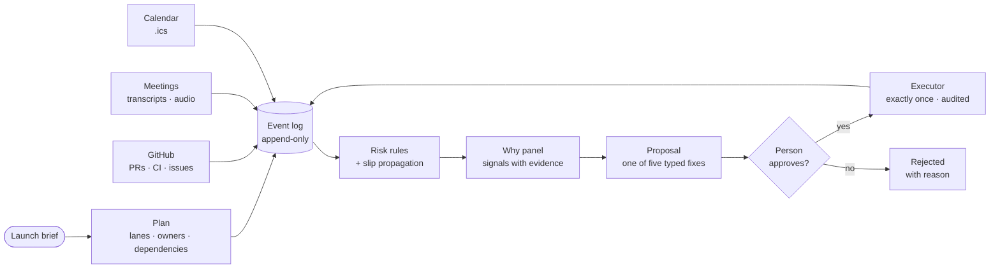

# Product overview

**Daelys: see what's slipping before the launch does.**

> Daelys turns a messy launch brief into a plan, watches the real work (GitHub, meetings, calendar), computes what
> is slipping and why with cited evidence, and proposes fixes that a person approves before anything happens.

## The problem

A launch lead needs three answers every morning: what is slipping, why, and what to do about it. The facts are
spread across GitHub (PRs, CI runs), standups (often in Hinglish), a calendar and a brief nobody re-reads. AI
assistants that answer these questions directly make up risks that aren't there and take actions nobody reviewed,
so a lead can't trust them in launch week. The [case study](CASE_STUDY.md) covers the problem and the scope
decisions in one page.

## What Daelys promises

| Promise | How it is kept |
| --- | --- |
| **Computed** | Risk scores come from five SQL rules over the event log and a slip-propagation query. A model may explain a score; it can never set one. |
| **Cited** | Every generated sentence must cite `[evt:ID]` or `[doc:ID]` evidence it was given. Anything uncited is dropped before anyone sees it. When nothing survives, Daelys says "Not enough evidence". |
| **Reviewed** | The agent can only propose one of five typed fixes. A person approves, and only then does the executor act: exactly once, audited, with undo where possible. |
| **Isolated** | Every table has Postgres row-level security. Search filters by role inside SQL before ranking, so nothing crosses teams. |

## The loop

## Who it is for

| Person | Role in Daelys | What they do |
| --- | --- | --- |
| **Launch lead or engineering manager** | `owner` | Sets up projects, accepts plans, approves any fix, makes people project leads, resets the demo |
| **Team lead** | `lead` (and project lead) | Generates plans and proposals, approves fixes for their projects, maps meeting speakers, reads the audit log |
| **Engineer** | `member` | Reads the board and the why, uploads meeting transcripts, comments on tasks, asks questions |
| **Stakeholder** | `viewer` | Reads the board, health and summaries. Can't see meeting transcripts |
| **The agent** | `agent` | A principal with its own role and audit rows. Its permission on an executed action is `min(agent, approver)` |

## Features

| Area | What it does | Where |
| --- | --- | --- |
| **Plan from a brief** | Paste or upload a brief (text or PDF). The planner proposes lanes, owners, estimates and dependencies; each task links to the sentence it came from. Contradictions (such as two launch dates) become open questions. One repair retry, then a person reviews and accepts | `agents/planner.py`, `core/plans.py` |
| **Signals from real work** | GitHub webhooks and backfill, replayed scenarios, meeting extraction, `.ics` calendars and plan acceptance all append events | `connectors/` |
| **Risk** | Five rules: stale PR, CI failing near the due date, overdue upstream dependency, explicit blocker, overloaded owner. Slips carry down `depends_on` edges. Scores combine with a noisy-OR into *on track*, *watch* or *at risk* | `rules/` |
| **Why panel** | Every signal with its evidence events. An optional plain-language explanation passes the citation checker | `agents/explainer.py` |
| **Proposals** | The agent suggests `reassign`, `move_due`, `split`, `notify` or `comment_on_pr` (and `create_item` from meetings). The inbox shows an exact preview; approve, edit or reject with a reason | `agents/proposer.py`, `core/proposals.py` |
| **Execution and undo** | Approved proposals run once. Workspace changes can be undone with inverse events; email and PR comments can't be unsent and need stricter approval | `workers/execute.py` |
| **Meetings** | Labelled transcripts (`[00:12] Name: text`) or audio through Notiv's Whisper. Decisions, blockers and action items are extracted with line citations, then matched to tasks or turned into `create_item` proposals | `core/meetings.py`, `agents/meeting_extractor.py` |
| **Weekly summaries** | Per lane, Monday to Monday, every sentence cited | `agents/writers.py` |
| **Ask Daelys** | Questions answered only from what your role may see, with sources | `core/insights.py`, `core/retrieval.py` |
| **Duplicates** | Similar tasks are suggested for a lead to confirm or dismiss. Nothing is merged automatically | `core/insights.py` |
| **Time machine** | The board as it was at any moment, and replays of a scenario into a copy of the workspace | `rules/engine.py`, `core/sandbox.py` |
| **Audit log** | Every proposal step and action, by person or agent | `GET /audit` |
| **Live updates** | The board refreshes when risk changes, through Postgres `NOTIFY` and server-sent events | `core/realtime.py` |

## Approval tiers

| Tier | Actions | Who approves | Undo |
| --- | --- | --- | --- |
| 2: workspace | `reassign`, `move_due`, `split`, `create_item` | Owner, or a lead of the item's project | Yes (inverse events) |
| 3: external | `notify` (email), `comment_on_pr` | Owner, or a lead of the item's project. **Never** auto-approved | No |

Proposals expire after 48 hours. A workspace may allow tier-2 auto-approval (`policies.auto_approve_max_tier`, off by
default); tier 3 always needs a person.

## Screens

| Screen | Route | Purpose |
| --- | --- | --- |
| Landing | `#/` | What Daelys is, the real board with numbered callouts, principles, capabilities |
| Sign in | `#/login`, `#/login/<workspace>` | Workspace, email and password. Invite-only, so "Need access?" explains how access works |
| Onboarding | after the first sign-in | Three skippable steps: welcome, where risk comes from, who approves |
| Projects | `#/projects` | Greeting, workspace health, project cards, demo reset and time machine for owners |
| Project board | `#/projects/<id>` | Lanes of tasks with risk tags, the why panel, weekly summaries, dependency graph |
| Plan review | `#/projects/<id>/plan/<draft>` | The proposed plan beside the brief; hovering a task highlights its source sentence |
| Proposals | `#/proposals` | The inbox: pending, approved, executed, rejected, with exact previews |
| Meetings | `#/meetings`, `#/meetings/<id>` | Upload transcripts or audio, see extracted items with their lines, map speakers |
| Ask | `#/ask` | Questions answered with sources |
| Audit log | `#/audit` | Owners and leads only |
| Event | `#/events/<id>` | One piece of evidence, as recorded |

The look is described in [Design system](DESIGN_SYSTEM.md).

## What Daelys deliberately does not do

- No Gantt charts, custom fields, sprint velocity or WIP limits. Daelys sits on top of GitHub; it isn't a tracker.
- No built-in chat or presence avatars. It reads conversations; it doesn't host them.
- No mobile app, billing or signup funnel. Workspaces are invite-only.
- No Google Calendar OAuth. Calendars come in as read-only `.ics` uploads.
- No free-text actions, and no model-set risk scores.
- No speaker diarization for audio meetings. Owners come from labelled transcripts or a speaker mapping.

## Where to read next

- [Architecture](ARCHITECTURE.md): how it is built.
- [Evaluation](EVALUATION.md): how quality is measured.
- [QA report](project-management/QA_REPORT.md): what has been verified and what hasn't.
- [Milestones](project-management/MILESTONES.md): how it got here.
- [PRD](project-management/PRD.md): every requirement with its status.
