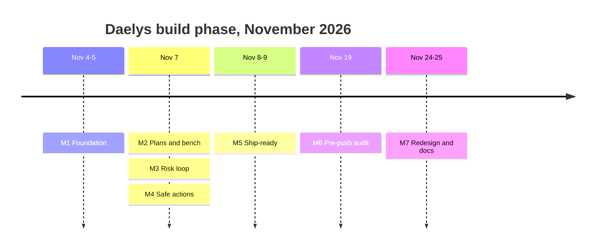

# Milestones

Sprints were scoped by deliverables and acceptance criteria, not fixed dates, so the dates below are **completion
dates** taken from the sprint reports. Each sprint's spec is in [`docs/process/sprints/`](../process/sprints/) and its
report, with real output, in [`docs/sprints/`](../sprints/).

## Summary

| ID | Milestone | Completed | Exit criteria met | Tests at exit |
| --- | --- | --- | --- | --- |
| M1 | Foundation and ingestion | 2026-11-05 | 4 of 6; 1 partly met, 1 not met (both need a repository) | 53 passed |
| M2 | Plan from a brief, DaelysBench, web shell | 2026-11-07 | 3 of 5 (2 need a model key) | 88 passed |
| M3 | The risk loop | 2026-11-07 | 4 of 4 | 112 passed |
| M4 | Proposals, approvals, execution, audit | 2026-11-07 | 2 of 3 (1 needs a GitHub App) | 136 passed |
| M5 | Meetings, summaries, search, ship-ready | 2026-11-09 | 2 of 4 (2 need accounts) | 156 passed |
| M6 | Pre-push audit | 2026-11-19 | All audit findings fixed | 159 tests |
| M7 | Redesign and documentation | 2026-11-25 | Done | 158 passed, 1 skipped |
| M8 | Measured with a live model | Not scheduled | — | — |
| M9 | Deployed | Not scheduled | — | — |
| M10 | Pilot with a real team | Not scheduled | — | — |

Every unmet criterion is blocked on an external dependency (a model key, a GitHub App, hosting accounts or a
pushed repository), not on unfinished code. Each one is an open item in the
[product backlog](PRODUCT_BACKLOG.md#4-open-backlog) and the [risk register](RISK_REGISTER.md).

## M1: Foundation and ingestion (2026-11-04/05)

**Goal:** a webhook or a replayed scenario becomes deduplicated events, projected into work items, and one workspace
can never see another's data.

| Exit criterion | Result |
| --- | --- |
| `make up && make migrate && make seed` works on a clean machine | Met on a clean volume; not from a git clone (no repository yet) |
| Isolation: other workspaces' IDs return 404; raw SQL with another tenant set returns zero rows | Met (`tests/test_isolation.py`) |
| Webhooks: valid signature accepted, bad signature 401, same delivery twice gives one event | Met (`tests/test_github_webhook.py`) |
| Replaying week 2 gives the expected events and work items | Met (`tests/test_replay.py`) |
| Worker restart resumes from its cursor | Met |
| CI runs the tests with Postgres | **Not met:** workflow written, never run (no repository) |

## M2: Plan from a brief, DaelysBench, web shell (2026-11-07)

**Goal:** a lead pastes a messy brief and gets a validated plan, and its quality is measured.

| Exit criterion | Result |
| --- | --- |
| Tests green, including validator tests | Met: 88 passed |
| Plan bench on 3 briefs with two model configs | **Not met:** harness built and tested; a real run needs a key |
| The Tiffin Box date contradiction becomes an open question | **Not met:** needs a key |
| Accepting a plan creates events and rebuilds work items | Met |
| Plan review works end to end in the web app | Met, with a fixture draft in place of the model call |

## M3: The risk loop (2026-11-07)

**Goal:** replaying week 2 flips launch health to At risk, and "why" shows the evidence.

| Exit criterion | Result |
| --- | --- |
| Unit tests for each rule and the propagation CTE, including a diamond | Met |
| Citation checker drops uncited and foreign-ID sentences | Met |
| Replaying week 2 flips health to At risk | Met (integration test) |
| Risk bench gives lead time and precision/recall | Met: 1.00 / 1.00, 2.64 days (draft labels) |

## M4: Proposals, approvals, execution, audit (2026-11-07)

**Goal:** typed fixes are proposed, approved or rejected, executed exactly once and audited, and prompt injection
executes nothing.

| Exit criterion | Result |
| --- | --- |
| Executor: unapproved and expired refused, double run gives one effect, undo restores | Met: 136 passed |
| Safety suite all pass | Met: 11/11 |
| Approving `comment_on_pr` posts exactly one comment on the real PR | **Not met:** no GitHub App; exactly-once verified against a local GitHub stand-in |

## M5: Meetings, summaries, search, ship-ready (2026-11-08/09)

**Goal:** meetings become tracked work, leads get cited summaries, anyone can ask within their permissions, and a
stranger can run the demo.

| Exit criterion | Result |
| --- | --- |
| Tests and bench green; README numbers generated | Met: 156 passed on the host; the README section is generated |
| Meetings suite reports English and Hinglish separately | Met in structure; both `n/a` until a key is set |
| Deployed URL works end to end | **Not met:** no hosting accounts; production image verified locally |
| Fresh clone works with only `.env` | **Not verified:** no repository |

The UI pass at the end of M5 found the three worst bugs of the project by using the app in a browser (a 239-day
slip, a blank screen, a connection limit); see the [QA report defect log](QA_REPORT.md#6-defect-log).

## M6: Pre-push audit (2026-11-19)

**Goal:** make the code safe to publish. Recorded as A-01 in [Technical decisions](../TECHNICAL_DECISIONS.md).
- Every upload is capped while streaming.
- Lost database listeners end live streams so browsers reconnect.
- The running app no longer needs owner database credentials.
- Security headers and request-ID validation.
- Compose restart policies; process documents moved under `docs/process/`.

Result: 159 tests; ruff, mypy and pip-audit clean.

## M7: Redesign and documentation (2026-11-24/25)

**Goal:** a consistent, professional product and documentation set for review.
- One journey from landing page to workspace, built from one AI-generated image and one cobalt blue, light only
  (D-01, [Design system](../DESIGN_SYSTEM.md)). It replaced an earlier reference image whose licence was unclear.
- The full documentation set, including this project-management folder.

Result: 158 passed, 1 skipped (macOS-only), 83% coverage, lint and type checks clean.

## Upcoming milestones

No dates are set: each depends on accounts or people outside the project.

| ID | Milestone | Exit criteria | Backlog items |
| --- | --- | --- | --- |
| M8 | Measured with a live model | All seven bench suites report numbers; the real-model safety case passes; English vs Hinglish published | PB-01, PB-02 |
| M9 | Deployed | A stranger completes the demo on the deployed URL; CI green on the pushed repository; fresh-clone check passes; a real PR comment posted once | PB-03, PB-04, PB-05, PB-07, PB-10, PB-13 |
| M10 | Pilot | One real team for two weeks; days of warning measured on real launches | PB-06 |
