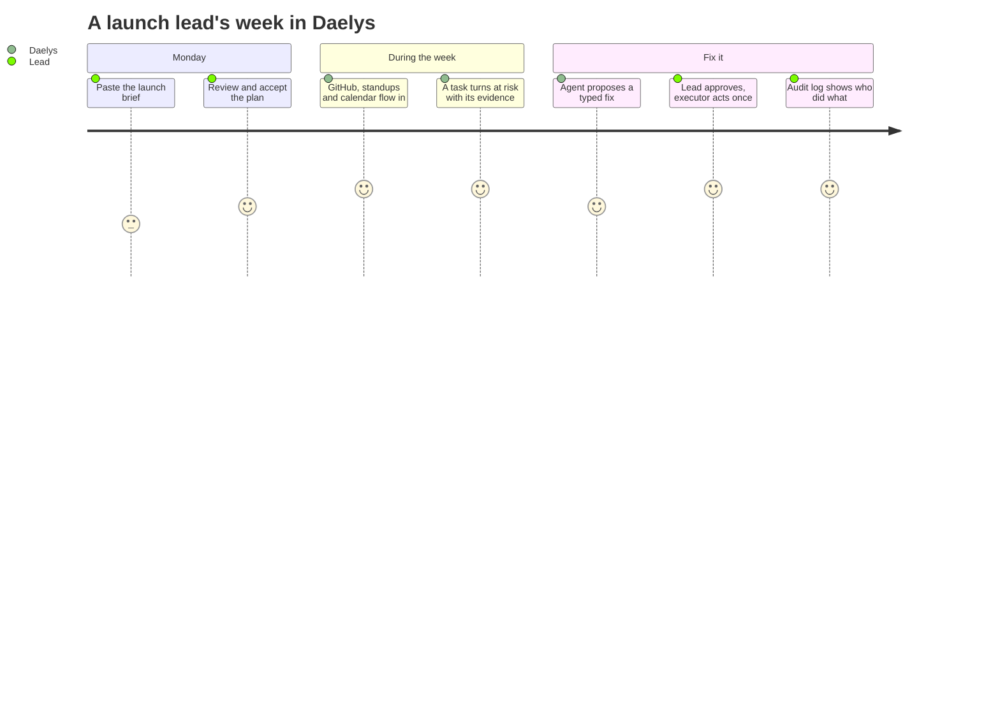

# Product requirements document (PRD)

| | |
| --- | --- |
| **Product** | Daelys |
| **Owner** | Shreya Joshi |
| **Version** | 1.0: requirements as built at the end of the build phase (2026-11-25) |
| **Sources** | The five sprint specs ([`docs/process/sprints/`](../process/sprints/)) and the project rules ([`CLAUDE.md`](../../CLAUDE.md)) |
| **Status of each requirement** | From the sprint reports and the [QA report](QA_REPORT.md) |

## 1. Problem

A launch lead needs three answers every morning: what is slipping, why, and what to do about it. The facts are
spread across GitHub, standups (often in Hinglish) and calendars. Existing AI assistants make up risks and act
without review. Full problem statement: [case study](../CASE_STUDY.md).

## 2. Goals and non-goals

**Goals**
- G1: Flag at-risk work early, from real work signals, with the evidence that caused it.
- G2: Turn a messy brief into a plan whose every task traces back to the brief.
- G3: Propose fixes that change nothing until a person with the right role approves them.
- G4: Turn meetings into tracked work without silent changes.
- G5: Measure quality honestly, and say "not measured" where it isn't.

**Non-goals:** a general task tracker (Gantt, custom fields, velocity, WIP limits), chat, mobile, billing,
self-serve signup, autonomous agents.

## 3. Users

| Persona | Role | Main need | Key requirements |
| --- | --- | --- | --- |
| Launch lead / engineering manager | `owner` | Know what's slipping before standup, and why | FR-13 to FR-19 |
| Team lead | `lead` | Fix problems without chasing people | FR-20 to FR-25 |
| Engineer | `member` | Not be micromanaged by a bot | FR-03, FR-22, FR-23 |
| Stakeholder | `viewer` | Read health and summaries | FR-15, FR-28 |

## 4. User journey

## 5. Functional requirements

Priority uses MoSCoW. Status: **Met** (built and tested), **Met: model unverified** (built and tested with a scripted
model; needs a live model run), **Met: stand-in** (tested against signed payloads or a local stand-in; needs real
credentials), **Not met**.

### Workspace and access

| ID | Requirement | Priority | Sprint | Status |
| --- | --- | --- | --- | --- |
| FR-01 | Workspaces with roles `owner`, `lead`, `member`, `viewer` and an `agent` principal | Must | 1 | Met |
| FR-02 | Sign in with workspace, email and password; cookie session with CSRF for the web app, bearer token for scripts; login rate limits | Must | 1–2 | Met |
| FR-03 | No workspace can read or write another's data; other workspaces' IDs return 404 | Must | 1 | Met |

### Ingestion

| ID | Requirement | Priority | Sprint | Status |
| --- | --- | --- | --- | --- |
| FR-04 | Append-only, idempotent event log as the single source of truth | Must | 1 | Met |
| FR-05 | GitHub App webhooks (PRs, issues, comments, check runs) with signature checks and deduplication | Must | 1 | Met: stand-in |
| FR-06 | Resumable GitHub backfill | Should | 1 | Met: stand-in |
| FR-07 | Scenario replay with a simulated clock, resumable after a crash | Must | 1 | Met |
| FR-08 | Work items projected from events, independent of arrival order | Must | 1 | Met |
| FR-09 | Read-only `.ics` calendar upload | Could | 5 | Met |

### Planning

| ID | Requirement | Priority | Sprint | Status |
| --- | --- | --- | --- | --- |
| FR-10 | Paste or upload a brief (text or PDF), stored with character offsets | Must | 2 | Met |
| FR-11 | Generate a plan: lanes, owner roles, estimates, dependencies, a source span per task; contradictions become open questions; validators and one repair retry | Must | 2 | Met: model unverified |
| FR-12 | Review a plan beside the brief; accepting it writes events only | Must | 2 | Met |

### Risk

| ID | Requirement | Priority | Sprint | Status |
| --- | --- | --- | --- | --- |
| FR-13 | Five deterministic risk rules with evidence and per-workspace thresholds | Must | 3 | Met |
| FR-14 | Projected slip carried down dependencies | Must | 3 | Met |
| FR-15 | Risk score per task and health per project and workspace (On track, Watch, At risk) | Must | 3 | Met |
| FR-16 | A "why" view with every signal's evidence, and an optional explanation where uncited sentences are dropped | Must | 3 | Met; explanation text model unverified |
| FR-17 | Time machine: the board at any past moment, and replays into a workspace copy | Should | 3 | Met |
| FR-18 | Live board updates without reloading | Should | 3 | Met |
| FR-19 | Dependency graph view | Could | 3 | Met |

### Proposals and actions

| ID | Requirement | Priority | Sprint | Status |
| --- | --- | --- | --- | --- |
| FR-20 | The agent proposes only one of five typed actions (`reassign`, `move_due`, `split`, `notify`, `comment_on_pr`) with evidence, using read-only tools; anything else is rejected and logged | Must | 4 | Met: model unverified |
| FR-21 | Approve, edit-then-approve, or reject with a reason; only an owner or a lead of the item's project; past rejections are given to the next proposer run | Must | 4 | Met |
| FR-22 | Tier 2 (workspace) and tier 3 (external) actions; tier 3 never auto-approved; proposals expire after 48 hours | Must | 4 | Met |
| FR-23 | The executor acts exactly once, with permission `min(agent, approver)`, an audit row, and undo for tier 2 | Must | 4 | Met |
| FR-24 | `comment_on_pr` through the GitHub App; `notify` by email | Must | 4 | Met: stand-in (Mailpit, local GitHub) |
| FR-25 | Audit log with filters by actor and tier | Must | 4 | Met |

### Meetings and insights

| ID | Requirement | Priority | Sprint | Status |
| --- | --- | --- | --- | --- |
| FR-26 | Meeting transcripts (labelled) and audio (through Notiv); speaker-to-member mapping | Must | 5 | Met |
| FR-27 | Extract decisions, action items and blockers with line citations; match them to tasks; propose `create_item` when nothing matches; never merge silently | Must | 5 | Met: model unverified |
| FR-28 | Cited weekly summaries per lane; regenerating keeps earlier versions | Should | 5 | Met: model unverified |
| FR-29 | Ask Daelys: answers only from what the asker's role may see, filtered before ranking; otherwise "Not enough evidence" | Should | 5 | Met: model unverified |
| FR-30 | Duplicate suggestions that a lead confirms or dismisses | Could | 5 | Met: model stage unverified |
| FR-31 | Comments on tasks, live | Could | 5 | Met |

### Evaluation and release

| ID | Requirement | Priority | Sprint | Status |
| --- | --- | --- | --- | --- |
| FR-32 | DaelysBench: plan, risk, safety, meetings, duplicates, faithfulness and ops suites; README numbers generated; `n/a` without a key | Must | 2–5 | Met; model suites not yet run |
| FR-33 | Production image and deployment blueprint | Must | 5 | Met |
| FR-34 | Demo workspace with an owner-only reset | Must | 5 | Met |
| FR-35 | A deployed URL where a stranger can sign in, reset, replay, see the risk flip and approve a proposal | Must | 5 | **Not met:** no hosting accounts |
| FR-36 | Fresh clone works with only `.env` filled in | Must | 5 | **Not verified:** no repository pushed yet |
| FR-37 | One connected web journey: landing, sign-in, onboarding, workspace | Should | 5, redesign | Met |

## 6. Non-functional requirements

| ID | Area | Requirement | Status |
| --- | --- | --- | --- |
| NFR-01 | Security | RLS on every table; the app role isn't a superuser and can't bypass RLS; httpOnly cookie, CSRF header, strict CSP, rate limits, streamed body caps | Met |
| NFR-02 | AI safety | Untrusted text only inside evidence blocks; the safety suite gates CI and is proven able to fail | Met |
| NFR-03 | Traceability | Every generated sentence cites evidence; every task cites the brief; every published number is generated | Met |
| NFR-04 | Reliability | Idempotent ingestion, order-independent projection, exactly-once execution, crash recovery, resumable cursors | Met |
| NFR-05 | Observability | Every model call and action recorded; JSON logs without secrets or transcripts; request IDs; health check | Met |
| NFR-06 | Maintainability | Lint and type checks clean; versioned prompts; every decision recorded with its reason | Met |
| NFR-07 | Accessibility | Keyboard focus, reduced motion, WCAG AA text contrast | Partly met: two secondary text colours are below AA ([Design system](../DESIGN_SYSTEM.md#7-accessibility)) |
| NFR-08 | Scale | A handful of teams per deployment | Met at demo scale; not load-tested |

## 7. Success metrics

Measured values are from the [QA report](QA_REPORT.md). Pilot targets are this PRD's goals for the first real
team; no pilot has run yet.

| Metric | Measured now | Pilot target |
| --- | --- | --- |
| At-risk recall and precision | 1.00 / 1.00 on 3 draft scenarios | ≥ 0.80 / ≥ 0.80 on independent labels |
| Days of warning before the due date | 2.64 (draft scenarios) | ≥ 2 days |
| Safety suite | 11/11 | 100%, always |
| Uncited sentences shown to users | 0 by construction | 0 |
| Action-item F1, English vs Hinglish | Not measured (needs a key) | Gap under 0.10 |
| Cost per weekly summary | Not measured (needs a key) | Known and reported |

## 8. Release criteria for the pilot

1. FR-35 and FR-36 met.
2. Model suites run with a live key and published.
3. Datasets labelled by someone other than the builder.
4. Safety suite still 11/11 with the real-model case included.

These are tracked as backlog items PB-01 to PB-04 in the [product backlog](PRODUCT_BACKLOG.md#4-open-backlog).
