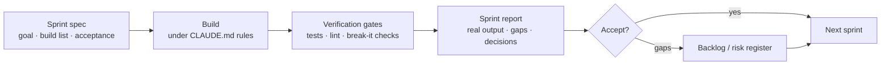

# Project charter

| | |
| --- | --- |
| **Project** | Daelys: an AI project manager for launch teams |
| **Owner and project manager** | Shreya Joshi |
| **Delivery approach** | Five spec-driven sprints with written acceptance criteria, verification gates and a report each |
| **Build phase** | 2026-11-04 to 2026-11-25 (see [Milestones](MILESTONES.md)) |
| **Status** | Build phase closed; validation phase open ([Closure report](CLOSURE_REPORT.md)) |

## 1. Purpose

Launch leads lose the first hour of every day stitching together what is slipping from GitHub, standups and
calendars. AI assistants that promise to do this make up risks and take actions nobody reviewed, so they can't be
trusted in launch week. Daelys exists to answer *what is slipping, why, and what should we do* with evidence for
every claim and a person approving every action.

## 2. Objectives

Each objective has a measure and its result at the end of the build phase. Details: [QA report](QA_REPORT.md).

| ID | Objective | Measure | Result |
| --- | --- | --- | --- |
| O1 | Detect at-risk work before it slips | Risk suite precision, recall and lead time | Met on draft data: precision 1.00, recall 1.00, 2.64 days before the due date |
| O2 | Never show an unsupported claim | Share of generated sentences without a valid citation that reach a user | Met by design: the citation checker drops them; faithfulness on a live model not yet measured |
| O3 | Never act without a valid, current approval | Safety suite (11 adversarial cases) | Met: 11/11, gating CI |
| O4 | Keep every workspace's data isolated | Isolation tests and RLS checks | Met: 8 isolation tests, RLS on every table |
| O5 | Be ready for a pilot team | Deployed, measured with a live model, independently labelled | **Not met:** needs an API key, accounts and a second labeller ([Roadmap](ROADMAP.md)) |

## 3. Scope

**In scope:** the full loop from brief to audited action:
1. a plan from a brief
2. signals from GitHub, meetings and calendars
3. computed risk with evidence
4. typed proposals, human approval, exactly-once execution with undo
5. meetings, summaries, search and duplicates
6. an evaluation harness, a production image and a web app

**Out of scope (cut on purpose):**
- Gantt charts, custom fields, sprint velocity, WIP limits
- built-in chat, presence avatars
- mobile app, billing, signup funnel
- Google Calendar OAuth
- free-text agent actions, model-set risk scores

The reasons are in the [case study](../CASE_STUDY.md#what-i-cut-and-why).

## 4. Deliverables

| Deliverable | Where |
| --- | --- |
| Working application (API, worker, web app) | `api/`, `workers/`, `web/` |
| Risk engine, agents and prompts | `rules/`, `agents/` |
| Evaluation harness (DaelysBench, 7 suites) | `evaluation/` |
| Test suite (159 tests against real services) | `tests/` |
| Production image and deployment blueprint | `Dockerfile`, `render.yaml` |
| Product, engineering and project documentation | `docs/` |

## 5. Constraints

Set before any code, in [`CLAUDE.md`](../../CLAUDE.md), and enforced in every sprint review:
1. Events are the source of truth; work items are a projection.
2. Risk is computed by rules, never generated by a model.
3. Every generated sentence carries evidence IDs or is dropped.
4. The agent proposes; only the executor acts, and only on approval.
5. Exactly five typed actions.
6. Row-level security on every table.
7. Untrusted text is evidence, never instructions.
8. No new dependency without a written reason.

## 6. Assumptions and dependencies

| Item | Status |
| --- | --- |
| An Anthropic API key for live model runs | Not available during the build; model features tested with scripted models |
| A GitHub App for real webhooks and PR comments | Not created; tested against signed payloads and a local stand-in |
| Render and Neon accounts for deployment | Not created; production image verified locally |
| Notiv (the owner's earlier project) for audio transcription | Available locally; optional |

## 7. Roles (RACI)

Daelys was built by one person, pair-programming with an AI coding assistant (Claude Code) under the project rules.
Every sprint's spec, acceptance decision and review was the owner's.

| Activity | Shreya Joshi (owner, PM) | Claude Code (AI pair programmer) |
| --- | --- | --- |
| Problem, scope, cut list, requirements | A, R | C |
| Architecture and design rules | A, R | C |
| Sprint specs and acceptance criteria | A, R | C |
| Implementation and tests | A | R |
| Verification gates and sprint sign-off | A, R | C |
| Evaluation design and datasets | A, R | R (draft labels) |
| Documentation | A | R |

R = responsible, A = accountable, C = consulted.

## 8. Governance

- **Status communication:** one report per sprint ([`docs/sprints/`](../sprints/)) with real test and bench output.
- **Decisions:** recorded with their reason in [Technical decisions](../TECHNICAL_DECISIONS.md).
- **Change control:** scope changes are recorded in the [closure report](CLOSURE_REPORT.md#5-scope-changes).
- **Definition of done:** in the [product backlog](PRODUCT_BACKLOG.md#3-definition-of-done).
