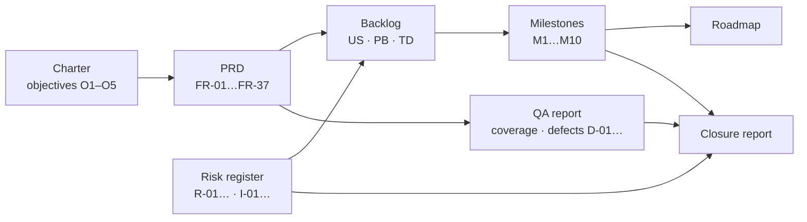

# Project management

How Daelys was scoped, planned, delivered, tested and closed. Every document here uses the same requirement IDs
(FR, NFR), milestone IDs (M), backlog IDs (PB, TD), risk IDs (R, I) and defect IDs (D), so a claim in one can be
followed into the others.

| Document | Answers |
| --- | --- |
| [Project charter](PROJECT_CHARTER.md) | Why the project exists, its objectives, scope, constraints, roles and governance |
| [PRD](PRD.md) | Who it's for and exactly what it must do: 37 functional and 8 non-functional requirements, each with its status |
| [Roadmap](ROADMAP.md) | What's built, what's next and what's later |
| [Milestones](MILESTONES.md) | Seven completed milestones with their exit criteria and results; three upcoming |
| [Product backlog](PRODUCT_BACKLOG.md) | Epics, delivered user stories, the definition of done, the open backlog and technical debt |
| [Risk register](RISK_REGISTER.md) | 17 risks with likelihood, impact, mitigation and status; issues that happened |
| [QA report](QA_REPORT.md) | Test strategy, requirements coverage, results, defect log and what isn't verified |
| [Closure report](CLOSURE_REPORT.md) | Objectives vs outcomes, scope changes, quality, lessons learned, handover and sign-off |

## How the documents connect

## The project in one table

| | |
| --- | --- |
| Build phase | 2026-11-04 to 2026-11-25, five sprints plus an audit and a redesign |
| Requirements | 35 of 37 functional requirements met; 2 need accounts |
| Quality | 159 tests (158 passed, 1 skipped), 83% coverage, safety suite 11/11 |
| Risk detection | Precision 1.00, recall 1.00, 2.64 days of warning (draft scenarios) |
| Open | Live-model measurement, independent labels, deployment, GitHub App, pilot |

## Where the process evidence lives

- Sprint specs, written before each sprint: [`docs/process/sprints/`](../process/sprints/)
- Verification gates and break-it checks: [`docs/process/verification/`](../process/verification/)
- Sprint reports with real output: [`docs/sprints/`](../sprints/)
- Decision log: [Technical decisions](../TECHNICAL_DECISIONS.md)
- Change history: [Changelog](../CHANGELOG.md)
