# Roadmap

The roadmap has three horizons. **Now** is what the build phase delivered. **Next** turns it into a measured,
deployed product. **Later** is improvement driven by a pilot. Every item links to the
[product backlog](PRODUCT_BACKLOG.md); dates for the next milestones are not set because each depends on accounts or
people outside the project ([Milestones](MILESTONES.md#upcoming-milestones)).

```mermaid
flowchart LR
    subgraph NOW["Now: built (M1–M7)"]
      A1[Event spine<br/>and isolation]
      A2[Plans from briefs]
      A3[Computed risk<br/>with evidence]
      A4[Typed proposals,<br/>approval, executor]
      A5[Meetings, summaries,<br/>Ask, duplicates]
      A6[DaelysBench,<br/>production image, web app]
    end
    subgraph NEXT["Next: validate (M8–M9)"]
      B1[Live-model bench run]
      B2[Independent labels]
      B3[Deploy + CI]
      B4[GitHub App<br/>end to end]
    end
    subgraph LATER["Later: pilot and improve (M10+)"]
      C1[Two-week pilot]
      C2[Automatic proposals<br/>after a risk flip]
      C3[Policy settings UI]
      C4[Scale: time-machine<br/>snapshots]
    end
    NOW --> NEXT --> LATER
```

## Now: delivered in the build phase

| Theme | What shipped | Milestone |
| --- | --- | --- |
| Trustworthy data | Append-only events, order-independent projection, row-level security | M1 |
| Plans | Brief to validated plan, every task traced to the brief | M2 |
| Risk | Five rules, slip propagation, why panel, time machine, live updates | M3 |
| Safe action | Five typed actions, tiers, exactly-once executor, undo, audit, safety suite | M4 |
| Meetings and insights | Transcripts and audio, cited extraction, summaries, Ask, duplicates, comments, `.ics` | M5 |
| Ready to publish | Hardening audit, redesign, documentation | M6, M7 |

## Next: validate (milestones M8 and M9)

| Item | Why it matters | Backlog | Blocked on |
| --- | --- | --- | --- |
| Run every bench suite with a live model | Plan quality, Hinglish vs English extraction, faithfulness and cost are unmeasured | PB-01 | An Anthropic API key |
| Independent labels and full datasets (15 briefs, 10 risk timelines, 10 meetings) | Today's scores only show the system agrees with its author | PB-02 | A second labeller, recorded meetings |
| Deploy to Render and Neon; run the stranger test | FR-35 | PB-03 | Hosting accounts |
| Push the repository; CI green; fresh-clone check | FR-36, CI has never run | PB-04 | A GitHub repository |
| GitHub App end to end: real webhooks and one real PR comment | FR-05, FR-24 | PB-05 | A GitHub App |
| Mailer with TLS and authentication | Real email for the `notify` action | PB-10 | — |
| Raise two secondary text colours to WCAG AA | NFR-07 | PB-13 | — |
| Record a 3-minute demo video | Lets reviewers see the loop without running it | PB-07 | — |

## Later: pilot and improve (M10 and after)

| Item | Why | Backlog |
| --- | --- | --- |
| Two-week pilot with a real launch team | The real test of days of warning and trust | PB-06 |
| Generate proposals automatically when a task turns at risk | Today a lead asks for them | PB-08 |
| Settings page for risk thresholds and auto-approval | Today these are database settings | PB-09 |
| Snapshots for the time machine | It rebuilds from all events per request | PB-11 |
| Map live GitHub repositories to projects | Today only replayed items belong to projects | PB-12 |

## Not on the roadmap

The cut list stands: Gantt charts, custom fields, sprint velocity, WIP limits, chat, presence avatars, mobile,
billing, self-serve signup and free-text agent actions. Reasons: [case study](../CASE_STUDY.md#what-i-cut-and-why).
